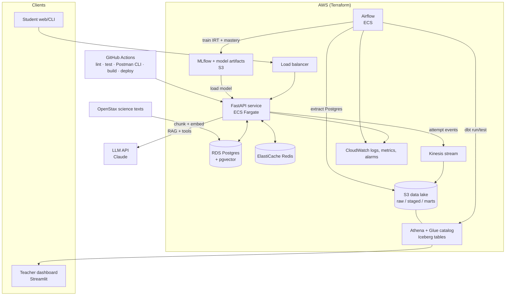

# Capstone: QuizLab — an adaptive science-learning platform

QuizLab grows out of the science question bank in [database/](../database/). High-school students take science quizzes. The platform records every answer, turns the answers into analytics and ML features, and uses an AI tutor to explain mistakes and choose the next best question. Teachers see class progress on a dashboard.

**One public GitHub repo, `quizlab`, built layer by layer from Phase 0 to Phase 8.** The project track of each phase adds one layer, so the capstone is mostly finished by the time Phase 8 starts. Phase 8 is for integration, hardening and presentation.

## What it shows off

| Skill area | Shown by |
|---|---|
| CS foundations | Inverted-index search, complexity benchmarks, concurrency in workers |
| Databases | Normalized schema, migrations, indexes, transactions, pgvector |
| Backend | FastAPI service, auth, caching, background jobs, tested API contract |
| DevOps | Docker, Terraform, GitHub Actions CI/CD, AWS ECS/RDS, monitoring, cost control |
| Data engineering ★ | Event streaming, S3 lake (Parquet/Iceberg), Airflow, dbt star schema, data quality, Spark backfill |
| Data science | IRT question difficulty, mastery prediction, A/B test analysis |
| Analytics & viz | Teacher dashboard (my existing strength) |
| AI engineering | RAG tutor with citations, LLM question generation, eval harness, tool-using agent |

## Architecture (final state)



## Component → phase map

| Component | Built in | Phase file |
|---|---|---|
| Repo, uv, pre-commit, README, compose with Postgres | Phase 0 | [00-setup.md](phases/00-setup.md) |
| `quizlab` Python package + CLI, inverted-index search, benchmarks | Phase 1 | [01-cs-foundations.md](phases/01-cs-foundations.md) |
| Normalized schema, Alembic migrations, Faker seed, index tuning | Phase 2 | [02-databases.md](phases/02-databases.md) |
| FastAPI API, auth, Redis cache, background jobs, Postman collection | Phase 3 | [03-backend.md](phases/03-backend.md) |
| Terraform AWS stack, CI/CD, monitoring, budget alarm | Phase 4 | [04-devops-aws.md](phases/04-devops-aws.md) |
| Events → Kinesis → S3, Airflow, dbt star schema, Athena, data quality, Spark backfill | Phase 5 | [05-data-engineering.md](phases/05-data-engineering.md) |
| IRT difficulty, mastery model, MLflow, A/B test, teacher dashboard | Phase 6 | [06-data-science-ml.md](phases/06-data-science-ml.md) |
| pgvector RAG tutor, question generator + evals, next-question agent | Phase 7 | [07-ai-engineering.md](phases/07-ai-engineering.md) |
| Load test, security review, docs site, demo, write-up | Phase 8 | [08-capstone.md](phases/08-capstone.md) |

## Core data model (designed in Phase 2, extended later)

```
subjects(id, name)
topics(id, subject_id → subjects, name)
questions(id, topic_id → topics, grade, question_text, answer, difficulty_irt, source, status)
question_choices(id, question_id → questions, text, is_correct)
students(id, email, grade, class_id → classes, created_at)
classes(id, teacher_id → teachers, name)
teachers(id, email, name)
quiz_sessions(id, student_id → students, started_at, finished_at, mode)
attempts(id, session_id → quiz_sessions, question_id → questions, answer_given, is_correct, time_ms, hint_used, created_at)
doc_chunks(id, source, chapter, text, embedding vector)          -- Phase 7
generated_questions(id, prompt_version, model, draft, eval_scores, review_status)  -- Phase 7
```

Warehouse (Phase 5, Kimball star schema): `fct_attempts`, `fct_quiz_sessions`, `dim_student`, `dim_question`, `dim_topic`, `dim_date`, and the mart `mart_student_topic_mastery`.

## Repo layout (target)

```
quizlab/
  README.md                 # pitch, architecture diagram, quickstart, demo link
  docs/
    adr/                    # one decision record per phase (why Postgres, why ECS, why dbt…)
    db-performance.md
    data-platform.md
    ml-report.md
    ai-evals.md
  src/quizlab/              # package: domain, search, api, services, ml, ai
  migrations/               # Alembic
  tests/                    # pytest (unit, integration)
  postman/                  # collection + environments, run by Postman CLI in CI
  pipelines/
    airflow/dags/
    dbt/                    # models, tests, docs
    spark/
  ml/                       # training notebooks → scripts, MLflow
  dashboard/                # Streamlit teacher app
  infra/terraform/          # modules: network, ecs, rds, s3, kinesis, iam, monitoring
  .github/workflows/        # ci.yml, deploy.yml, data-ci.yml
  compose.yaml              # whole stack locally
```

## Final demo checklist (Phase 8)

- [ ] `docker compose up` runs the full stack locally in under 5 minutes from a fresh clone.
- [ ] `terraform apply` builds the AWS stack and `terraform destroy` tears it down cleanly.
- [ ] A student session in the demo produces events that reach the warehouse and the dashboard within the documented latency.
- [ ] The tutor answers with citations to OpenStax chapters, and the eval report shows the scores.
- [ ] CI is green: unit tests, Postman CLI contract tests, dbt tests, Terraform plan.
- [ ] README has the architecture diagram, a 3-minute demo video, and "what I'd do next".
- [ ] Monthly AWS cost is documented and stays under budget (target ≤ $30/month while running, $0 when torn down).
