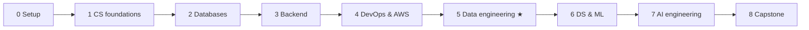

# Learning Path: From Data Analyst to Data, Backend, DevOps and AI Engineer

**Start:** Mon 2026-11-30 · **Finish:** Sun 2028-09-17 (+ launch week) · **Pace:** 8–10 h/week · **Cloud:** AWS

## Where I am starting

| Level | Skills |
|---|---|
| Experienced | Python, data analysis, visualization (3 years) |
| Beginner | Databases (PostgreSQL, CS50 SQL in progress), Docker, DevOps |
| New | CS theory, backend, cloud, data engineering tooling, ML/AI engineering |

Already in progress: the science question bank in [database/](../database/) (PostgreSQL 17 in Docker, psycopg, CSV import). See [database/learning-progress.md](../database/learning-progress.md). **That project becomes the seed of the final capstone.**

## Where I am going

By September 2028 I will have:

1. A solid **computer science foundation**: algorithms, data structures, operating systems, networking, databases.
2. A working **data science foundation**: statistics, experiments, classical ML.
3. **Mastery of data engineering**: lakes, warehouses, orchestration, modeling, batch and streaming, data quality.
4. Production-level **backend**, **DevOps/AWS** and **AI engineering** skills.
5. **QuizLab**, one public portfolio project that uses all of the above. See [capstone.md](capstone.md).

---

## How the two tracks work

Every week has a **theory track** and a **project track** that cover the same topic.

| Session | Time | What I do |
|---|---|---|
| Theory 1 | ~2 h | Read/watch the week's resource. Take notes **in my own words**. |
| Theory 2 | ~2 h | Finish the resource. Write 3–5 recall questions and answer them without notes. |
| Project 1–3 | ~4.5 h | Build the week's task in the `quizlab` repo using [my practice loop](../docs/how-to-practice-coding.md): plan → attempt → smallest AI hint → review → redo from blank. |
| Sunday review | 30 min | Save the weekly log in the [tracker](tracker/README.md) (or [progress.md](progress.md)): what I did, what broke, next step. Answer last week's recall questions again. |

Rules:
- **Theory first in the week, project after.** The project is where theory gets tested.
- **AI helps, it does not write the code for me.** I ask for hints, explanations and reviews. I must be able to explain every line I commit.
- **A buffer week follows every phase.** I use it to catch up, review the "Done when" list, write the phase retrospective, or rest. I never skip it to rush ahead.
- **If I fall behind by 2+ weeks**, I cut that phase's stretch goals first, never the "Done when" items.

## Threads (skills practised in every phase)

| Thread | From | Habit |
|---|---|---|
| Git & GitHub | Phase 0 | Small commits, feature branches, pull requests to myself, a clean README |
| Testing | Phase 1 | Every new module gets `pytest` tests; CI runs them from Phase 4 |
| Docker | Phase 0 | Every service runs with `docker compose up` |
| DSA practice | Phase 1 | 1 LeetCode problem/week in [python/](../python/) after Phase 1 ends |
| Writing | Phase 0 | One README section + one ADR (architecture decision record) per phase |
| SQL | Phase 2 | 1 hard SQL exercise/week (window functions, CTEs) |
| Statistics | Phase 3 | 1 StatQuest video (~15 min) per week, so Phase 6 is a step up, not a restart |

---

## Phase map

| # | Phase | Weeks (global) | Dates | Main outcome |
|---|---|---|---|---|
| 0 | [Setup & habits](phases/00-setup.md) | W1–W2 (+W3 buffer) | 2026-11-30 → 2026-12-20 | Tooling ready, `quizlab` repo created, CS50 SQL checkpoint finished |
| 1 | [CS foundations](phases/01-cs-foundations.md) | W4–W15 (+W16) | 2026-12-21 → 2027-03-21 | Algorithms, OS, networking; question bank becomes a tested Python package |
| 2 | [Databases](phases/02-databases.md) | W17–W24 (+W25) | 2027-03-22 → 2027-05-23 | Normalized schema, migrations, 1M-row seed, index tuning |
| 3 | [Backend engineering](phases/03-backend.md) | W26–W35 (+W36) | 2027-05-24 → 2027-08-08 | FastAPI quiz API with auth, cache, tests, Postman collection |
| 4 | [DevOps & AWS](phases/04-devops-aws.md) | W37–W46 (+W47) | 2027-08-09 → 2027-10-24 | API live on AWS via Terraform and GitHub Actions CI/CD |
| 5 | [Data engineering](phases/05-data-engineering.md) ★ | W48–W61 (+W62) | 2027-10-25 → 2028-02-06 | Lake + warehouse + Airflow + dbt + streaming for learning events |
| 6 | [Data science & ML](phases/06-data-science-ml.md) | W63–W72 (+W73) | 2028-02-07 → 2028-04-23 | Question difficulty (IRT), mastery model, A/B test, teacher dashboard |
| 7 | [AI engineering](phases/07-ai-engineering.md) | W74–W85 (+W86) | 2028-04-24 → 2028-07-23 | RAG tutor, LLM question generator with evals, next-question agent |
| 8 | [Capstone integration](phases/08-capstone.md) | W87–W94 (+W95 launch) | 2028-07-24 → 2028-09-24 | Hardened, documented, demoed QuizLab and portfolio |

★ = mastery focus (longest phase).

**Why this order.** Data science comes after data engineering, not straight after CS. With 3 years of analysis behind me, I already have a head start in DS. I also need a real data platform, with real event data, before modeling is worth doing. The order follows dependencies: a database comes before the API that writes to it; the API comes before the cloud it runs on; the platform comes before the pipelines that collect its events; the data comes before the models trained on it; and models plus data come before AI features. Statistics review starts early as a light thread (see Threads above), so DS in Phase 6 is a step up, not a restart.

## Milestones (show-off checkpoints)

| Date | Milestone | Proof |
|---|---|---|
| 2027-03-21 | `quizlab` CLI package with search, tests, README | GitHub repo + test badge |
| 2027-05-23 | Schema redesign + performance report | `docs/db-performance.md` with EXPLAIN before/after |
| 2027-08-08 | Local API stack | `docker compose up` → working Swagger UI |
| 2027-10-24 | **Live on AWS** | Public URL, green CI pipeline, Terraform code |
| 2028-02-06 | **Data platform** | Airflow DAGs, dbt docs site, warehouse dashboard |
| 2028-04-23 | ML models in production | MLflow runs, `/students/{id}/mastery` endpoint, A/B report |
| 2028-07-23 | AI tutor | `/tutor` endpoint with citations, eval report |
| 2028-09-24 | **Launch** | Demo video, architecture write-up, blog post, updated CV |

## Files in this folder

- [learning-path.md](learning-path.md): this overview
- [capstone.md](capstone.md): QuizLab architecture and which phase builds each part
- [tracker/](tracker/README.md): **local website** to tick off tasks and log each week. Run it with `uv run --with streamlit streamlit run cs-foundation/tracker/app.py`
- [progress.md](progress.md): Markdown version of the weekly tracker (optional if you use the website)
- [phases/](phases/): one detailed file per phase with week-by-week theory and project tables

## Optional certifications

Certifications are optional. They help with job applications but don't replace the project.
- **AWS Certified Cloud Practitioner** at the end of Phase 4 (easy, ~2 extra weeks of review).
- **AWS Certified Data Engineer – Associate** after Phase 5. This one is most aligned with the career goal.
- **dbt Analytics Engineering** certification after Phase 5 (optional).
